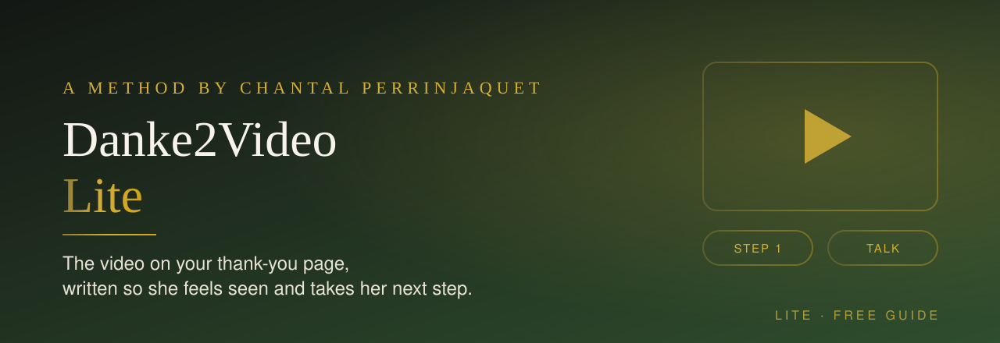
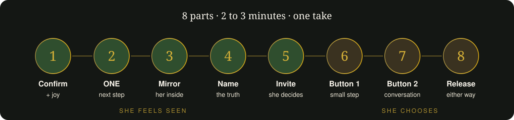

  

  
  
  

<h3 align="center">She just said yes. Now your thank-you page speaks to her like you would.</h3>

---

## 💭 Does this sound familiar?

- Your thank-you page says "Check your inbox" and nothing else.
- People sign up for your workshop and never show up.
- Someone buys your test or eBook, and you never hear from her again.

The moment right after her yes is the moment with the most attention in your whole funnel. Most coaches leave it empty.

This free guide shows you how to fill it: **a 2 to 3 minute video on your thank-you page**, recorded in one take. It works for any expertise and any offer, for live workshops and challenges as well as tests, quizzes, eBooks and PDFs.

---

## 🎬 The 8 parts

  

| # | Part | Time | What it does |
|---|---|---|---|
| 1 | **Confirmation + joy** | 0:00–0:10 | Start with her decision, not with "Hi, I'm…". Your name comes after |
| 2 | **The ONE next step** | 0:10–0:35 | Exactly one action. Event: open the email, save the date. Test or eBook: do it today |
| 3 | **Mirroring** | 0:35–0:55 | What works on the outside, the sentence she thinks at night, what she longs for |
| 4 | **Naming** | 0:55–1:10 | One or two sentences: what is really going on, and that it can change |
| 5 | **Invitation** | 1:10–1:15 | "If you recognise yourself…" Two buttons below the video. She decides |
| 6 | **Button 1: the small step** | 1:15–1:45 | What it is, 3 concrete things inside, the price |
| 7 | **Button 2: the conversation** | 1:45–2:15 | Who it is for and what she leaves with. No price |
| 8 | **Recap + release** | 2:15–2:40 | The actions in one breath. "Either way, I'm glad you're here" |

---

## ✍️ Your fill-in script

Copy this, fill in the brackets, then read it out loud and change every word that doesn't sound like you.

> **1** · You did it. Your **[gift]** is waiting for you, and I'm really glad you're here. I'm **[name]**. Watch this short video to the end, it matters.
>
> **2** · *Event:* In the next few minutes you'll get an email with **[link, date, workbook]**. Open it and put the date in your calendar right away.
> *Instant:* Do your **[test / eBook]** today. Not someday. It takes **[X] minutes**, just for you.
>
> **3** · If you're here, I already know a few things about you. **[Who she is]**. From the outside, **[what works]**. And inside, you sometimes think: "**[the sentence she tells almost nobody]**". And you wish, very honestly, **[her deep wish]**.
>
> **4** · Nothing is wrong with you. **[What is really going on, in her words]**. And exactly that can change, step by step.
>
> **5** · If you recognise yourself in this, you'll find two buttons below this video. Let me tell you briefly what's behind them.
>
> **6** · The first button is **[small step]**. Inside you'll find **[3 concrete things]**. It's **[price]**.
>
> **7** · The second button is for you if you feel: I don't want to search for solutions alone anymore. Behind it, **[choose a date / write me]** for a free clarity conversation with me. Whether we work together afterwards or not, you leave with clarity.
>
> **8** · So: **[the one action]**. If you want to go deeper right away, **[small step]**. If you want to walk this way together with me, book your conversation. Either way, I'm so glad you're here.

Want to see a finished script? Read the fictional example: [`example.md`](example.md)

---

## ✅ Check before you record

- [ ] 300 to 380 spoken words (2:00 to 2:45). Too long? Shorten part 7 first
- [ ] Only ONE action in part 2
- [ ] No button, product or price before part 5
- [ ] No income promises, no fake scarcity, no countdown
- [ ] A price only for Button 1, never for the conversation
- [ ] The sentence in part 3 is **her** sentence, not yours
- [ ] You end with a release, so the decision stays with her

---

## 🌿 Created by Chantal Perrinjaquet

  

  <b>SoulStrategy Architect · Medium · House of Coaching</b> 
  23 years in business. I decode the unique perception of successful spiritual entrepreneurs 
  and help them turn it into their own method, deeper groups and a team that carries their values.

  Want more practical hacks like this one, ready to use right away in your soul business? 
  Subscribe to my AI-Blog on Substack.

  
  

---

## License

© 2026 Chantal Perrinjaquet. This free guide is licensed under [CC BY-NC-ND 4.0](https://creativecommons.org/licenses/by-nc-nd/4.0/): you may use and share it unchanged, with credit to Chantal Perrinjaquet, for non-commercial purposes. No adapted versions. Licensing for teams and partners: write **SKILLS** on [WhatsApp](https://bit.ly/My-SoulMission).
